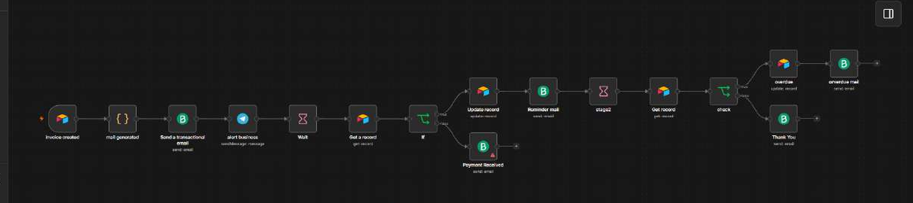
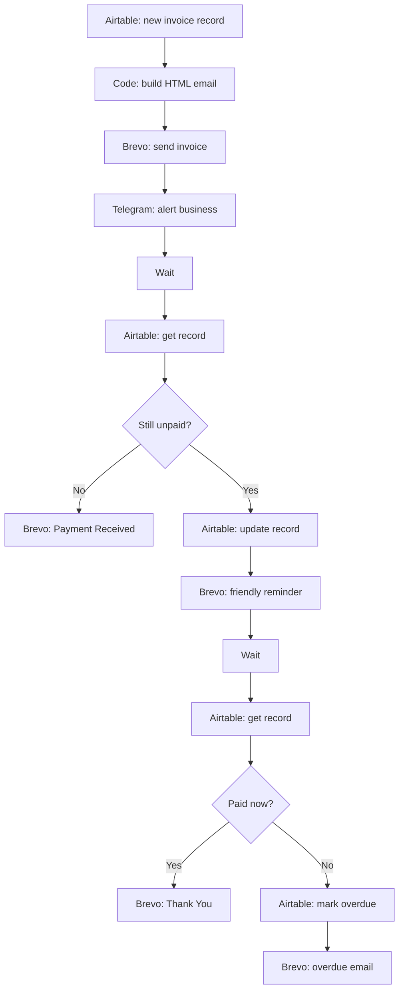
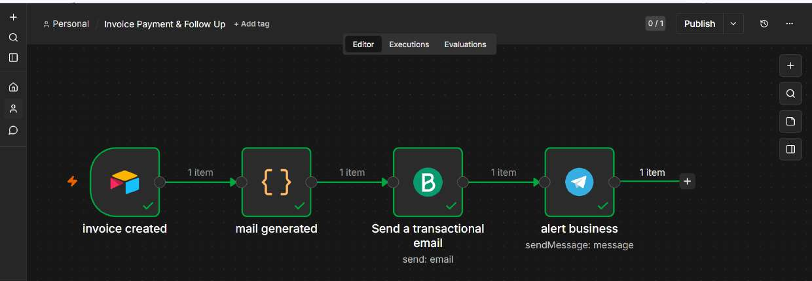
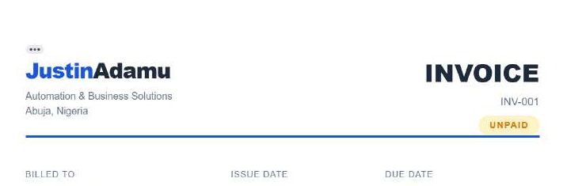
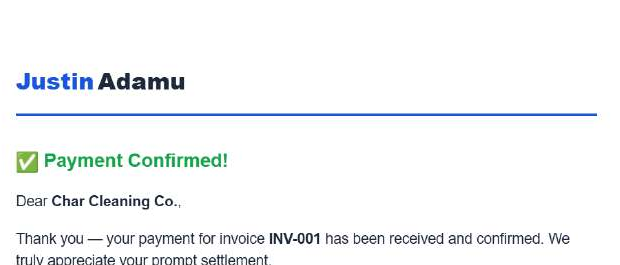
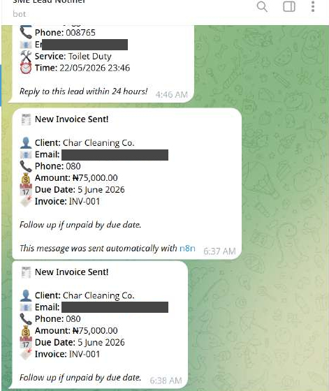

# n8n Invoice Payment and Follow-Up Automation

An n8n workflow that sends a branded invoice email as soon as a new invoice record is created in Airtable, alerts the business on Telegram, then checks payment status after set delays and sends a friendly reminder, an overdue notice, or a payment confirmation as appropriate.



## The problem

Small businesses lose time and cash flow chasing late payments by hand. Invoices go out late, reminders are inconsistent, and nobody remembers who has paid. This workflow handles the sending and the chasing, and leaves the owner to deal only with exceptions.

## What it does

1. A new record in the Airtable **Invoices** table triggers the workflow.
2. A **Code node** builds the HTML invoice email from the record (client, amount, due date, invoice number).
3. **Brevo** sends the invoice to the client.
4. **Telegram** alerts the business that an invoice has gone out.
5. After a **Wait**, the workflow re-reads the invoice from Airtable.
   - If it is **paid**, Brevo sends a Payment Received email and the flow ends.
   - If it is **unpaid**, the record is updated and Brevo sends a friendly reminder.
6. After a second **Wait**, the workflow checks again.
   - If it is **paid**, Brevo sends a Thank You email.
   - If it is **still unpaid**, the record is marked overdue and Brevo sends an overdue notice.



## Screenshots



| Invoice email | Payment confirmation email |
|---|---|
|  |  |



All client names, amounts and contact details are sample test data.

## Tech stack

| Tool | Role |
|---|---|
| n8n (self-hosted on Railway) | Workflow engine |
| Airtable | Invoice database and trigger |
| Code node (JavaScript) | Builds the HTML invoice email |
| Brevo | Transactional email |
| Telegram Bot API | Business alerts |

## Repository structure

```
n8n-invoice-payment-followup/
├── README.md
├── LICENSE
├── .env.example
├── .gitignore
├── workflow/
│   └── invoice-payment-follow-up.json   # sanitised n8n export
└── docs/
    ├── architecture.md                  # node by node breakdown
    ├── setup-guide.md                   # how to rebuild this from scratch
    ├── testing.md                       # test cases and what I found
    └── images/
```

## Quick start

1. Read [docs/setup-guide.md](docs/setup-guide.md) and prepare the Airtable base, Brevo account and Telegram bot.
2. In n8n, choose **Import from file** and select `workflow/invoice-payment-follow-up.json`.
3. Attach your own Airtable, Brevo and Telegram credentials.
4. Shorten the Wait nodes for testing, then create a test invoice in Airtable.
5. Change the invoice status in Airtable to see the paid and unpaid paths.

The exported JSON contains no credentials. Reconnect them after import.

## What I tested

I ran sample invoices through the flow and checked the invoice email, the Telegram alert, the reminder and the payment confirmation. See [docs/testing.md](docs/testing.md).

## Known limitations and next steps

- **Fixed waiting periods.** Reminder timing is set in Wait nodes. Next step: base timing on each invoice's due date.
- **One currency and layout.** The email template is written for naira invoices with a single line item. Next step: support multiple line items and currencies.
- **Manual payment status.** Someone must mark the invoice paid in Airtable. Next step: connect a payment webhook so payment updates the record automatically.
- **No error handling.** A failed email or Airtable call stops the flow silently. Next step: add an error workflow that alerts the owner.
- **Wait nodes hold executions open.** For large invoice volumes, a scheduled workflow that scans for due invoices would scale better.

## Author

Justin Charles Adamu, automation specialist, Abuja, Nigeria.
