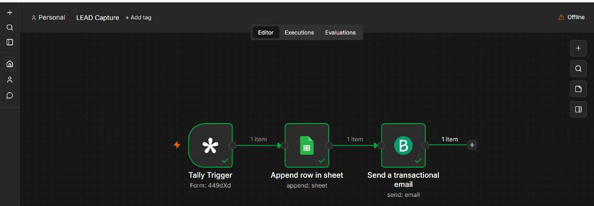
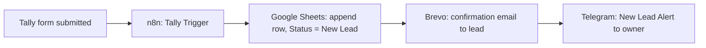
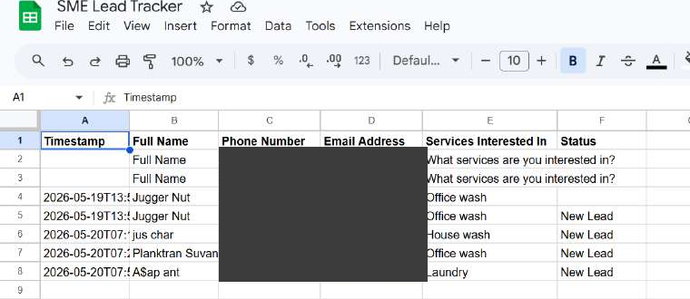
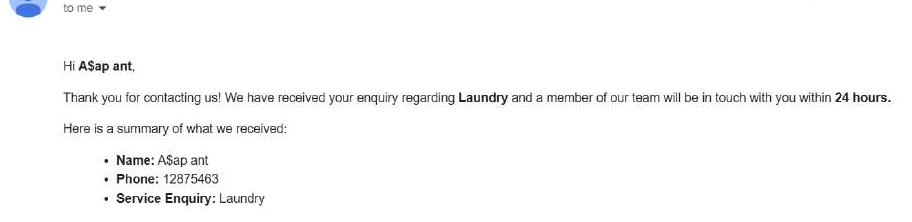
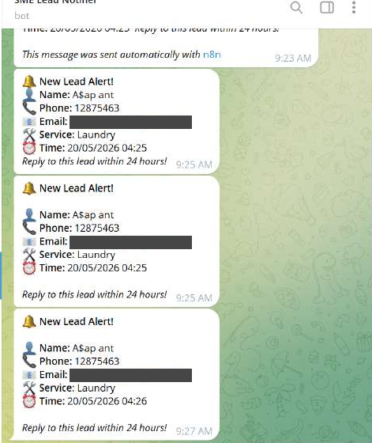

# n8n Lead Capture and Instant Follow-Up

An n8n workflow that captures every form enquiry, logs it to a spreadsheet, sends the lead an instant confirmation email, and alerts the business owner on Telegram. Built for small service businesses that lose leads because nobody replies quickly.



## The problem

Small businesses often receive enquiries through forms and messages, then answer hours later. Leads go cold, and there is no central record of who asked for what. This workflow removes the manual steps between "someone filled in the form" and "someone is following up".

## What it does

1. A visitor submits a **Tally** form (name, phone, email, service of interest).
2. **n8n** receives the submission through the Tally Trigger node.
3. The lead is appended to a **Google Sheets** lead tracker with a timestamp and the status `New Lead`.
4. **Brevo** sends the lead a personalised confirmation email that names the service they asked about and promises a reply within 24 hours.
5. A **Telegram** bot sends the owner a "New Lead Alert" with the lead's name, phone, email, service and time.



## Screenshots

| Lead log in Google Sheets | Confirmation email sent to the lead |
|---|---|
|  |  |



All data shown is sample test data. Phone numbers and email addresses are redacted or fictional.

## Tech stack

| Tool | Role |
|---|---|
| n8n (self-hosted on Railway) | Workflow engine |
| Tally | Lead capture form |
| Google Sheets | Lead log |
| Brevo | Transactional email |
| Telegram Bot API | Owner notification |

## Repository structure

```
n8n-lead-capture-autoresponder/
├── README.md
├── LICENSE
├── .env.example
├── .gitignore
├── workflow/
│   └── lead-capture.json        # sanitised n8n export
└── docs/
    ├── architecture.md          # node by node breakdown and data mapping
    ├── setup-guide.md           # how to rebuild this from scratch
    ├── testing.md               # test cases and what I found
    └── images/
```

## Quick start

1. Read [docs/setup-guide.md](docs/setup-guide.md) and create the Tally form, Google Sheet, Brevo account and Telegram bot.
2. In n8n, choose **Import from file** and select `workflow/lead-capture.json`.
3. Attach your own credentials to the Tally, Google Sheets, Brevo and Telegram nodes.
4. Submit a test entry on the form and check the sheet, your inbox and Telegram.

The exported JSON contains no credentials. n8n keeps those separately, so you must reconnect them after import.

## What I tested

I ran repeated end to end test submissions with sample data and checked each of the three outputs (sheet row, email, Telegram message). Details are in [docs/testing.md](docs/testing.md).

## Known limitations and next steps

- **No duplicate protection.** Submitting the same lead twice creates two rows and two alerts. Next step: look up the email in the sheet before appending.
- **No input validation.** Phone and email formats are not checked before the row is written. Next step: add an IF node or form-side validation.
- **No error handling.** If Brevo or Telegram fails, nothing retries and nobody is told. Next step: add an error workflow that notifies the owner.
- **Single form.** The workflow is wired to one Tally form ID.

## Adapting it

The same pattern works for any business that takes enquiries: salons, agencies, schools, property managers. Change the form fields, the sheet columns and the email copy.

## Author

Justin Charles Adamu, automation specialist, Abuja, Nigeria.
