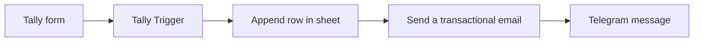

# Architecture

## Flow

## Nodes

| # | Node | Type | Purpose |
|---|---|---|---|
| 1 | Tally Trigger | Trigger | Starts the workflow when the Tally form is submitted. Registers a webhook with Tally for the chosen form. |
| 2 | Append row in sheet | Google Sheets | Writes the lead into the lead tracker. |
| 3 | Send a transactional email | Brevo | Sends a personalised confirmation to the lead. |
| 4 | Telegram message | Telegram | Sends the owner a formatted New Lead Alert. |

## Data mapping

| Form field | Sheet column | Used in email | Used in Telegram alert |
|---|---|---|---|
| Full name | Full Name | Greeting | Name |
| Phone number | Phone Number | Summary list | Phone |
| Email address | Email Address | Recipient | Email |
| What services are you interested in? | Services Interested In | Subject of enquiry | Service |
| (generated) | Timestamp | none | Time |
| (set by workflow) | Status = `New Lead` | none | none |

## Design decisions

- **Google Sheets as the data store.** Free, familiar to non-technical owners, and viewable from any phone.
- **Brevo for email.** A transactional email node gives reliable delivery from a verified sender, which matters more than a plain SMTP node.
- **Telegram for alerts.** Free, instant, and works on the owner's phone without extra apps.
- **Self-hosted n8n on Railway.** Keeps running costs low and lets the workflow run around the clock.
